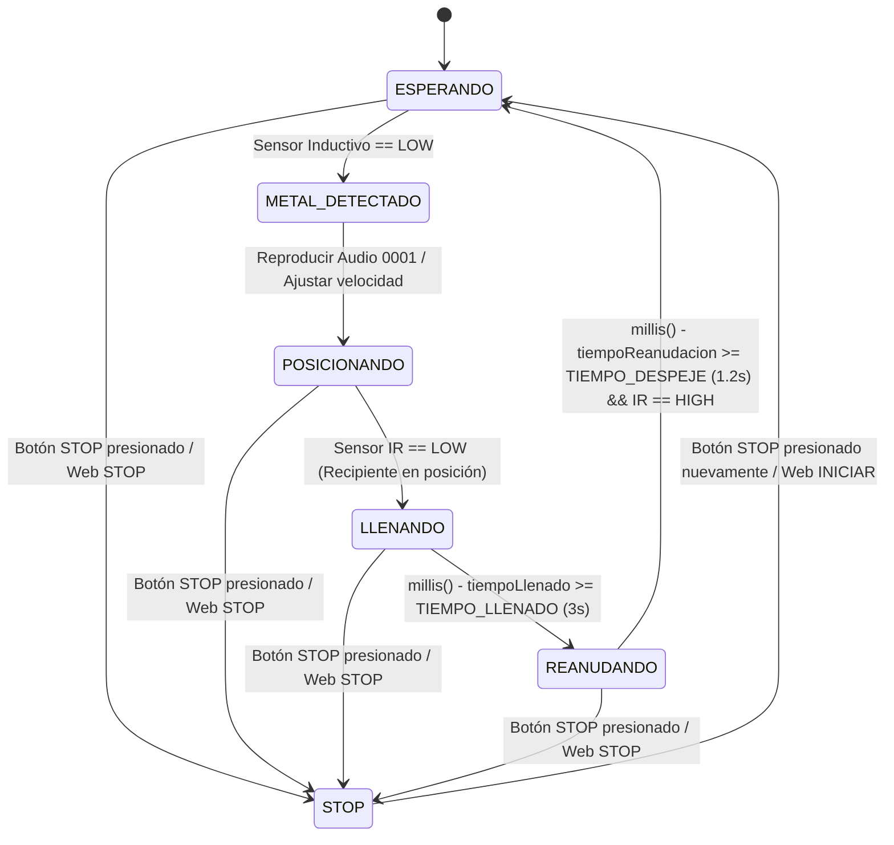

# Máquina de Estados del Sistema (FSM Non-Blocking)

El firmware implementa una máquina de estados finitos completamente asíncrona y no bloqueante basada en temporizadores de hardware con la función `millis()`.

---

## 1. Diagrama de Transición de Estados

---

## 2. Descripción de Estados y Acciones

### 1. `ESTADO_ESPERANDO`
- **Acciones:**
  - Motor de la banda en marcha continua a velocidad nominal (`VELOCIDAD_BANDA_NOMINAL = 200/255`).
  - Electroválvula desactivada (cerrada).
  - Pantalla TFT en color verde indicando "ESPERANDO RECIPIENTE".
- **Disparador de salida:**
  - Si el sensor inductivo LJ12A3-4-Z/BX detecta masa metálica (señal en nivel bajo `LOW`), se produce la transición a `ESTADO_METAL_DETECTADO`.

### 2. `ESTADO_METAL_DETECTADO`
- **Acciones:**
  - Envía instrucción al DFPlayer Mini para reproducir `0001.mp3` ("Recipiente metálico detectado").
  - Muestra mensaje de confirmación en pantalla TFT en color cyan.
  - Transición inmediata hacia `ESTADO_POSICIONANDO`.

### 3. `ESTADO_POSICIONANDO`
- **Acciones:**
  - Reduce la velocidad del motor de la banda a `VELOCIDAD_BANDA_LENTA = 140/255` para permitir una parada precisa sin inercia excesiva.
  - Monitorea continuamente el sensor infrarrojo FC-51 situado bajo el cabezal de la electroválvula.
- **Disparador de salida:**
  - Cuando el sensor IR detecta el recipiente en la estación de llenado (salida en `LOW`), se detiene el motor y transiciona a `ESTADO_LLENANDO`.

### 4. `ESTADO_LLENANDO`
- **Acciones:**
  - Motor de la banda completamente detenido (`VELOCIDAD_BANDA_PARADA = 0`).
  - Activa la electroválvula 12V vía TB6612FNG Canal B (`POTENCIA_VALVULA_ON = 255`).
  - Reproduce `0002.mp3` ("Llenando").
  - Almacena marca de tiempo inicial `tiempoInicioLlenado = millis()`.
  - Dibuja barra de progreso gráfica en la pantalla TFT.
- **Disparador de salida:**
  - Al cumplirse el intervalo `TIEMPO_LLENADO_MS` (3000 ms), se desenergiza la electroválvula, incrementa el contador de unidades procesadas, reproduce `0003.mp3` ("Llenado completo") y transiciona a `ESTADO_REANUDANDO`.

### 5. `ESTADO_REANUDANDO`
- **Acciones:**
  - Electroválvula confirmada en estado cerrado.
  - Arranca de nuevo el motor de la banda a velocidad nominal para desalojar el recipiente lleno de la estación.
  - Almacena marca de tiempo de despeje `tiempoInicioReanudacion = millis()`.
- **Disparador de salida:**
  - Cuando transcurre el tiempo mínimo de despeje (`TIEMPO_DESPEJE_MS = 1200 ms`) Y el sensor IR reporta `HIGH` (haz infrarrojo libre sin obstrucción), el sistema retorna limpiamente a `ESTADO_ESPERANDO`.

### 6. `ESTADO_STOP` (Parada de Emergencia)
- **Acciones:**
  - Se interrumpe de inmediato cualquier actividad: motor detenido (PWM = 0) y electroválvula apagada.
  - Reproduce `0005.mp3` ("Sistema detenido").
  - Pantalla TFT muestra alerta en rojo: "SISTEMA DETENIDO".
- **Disparador de salida:**
  - Presionar de nuevo el botón físico de STOP o pulsar el botón "Iniciar" en la interfaz web reinicia la máquina hacia `ESTADO_ESPERANDO`.
